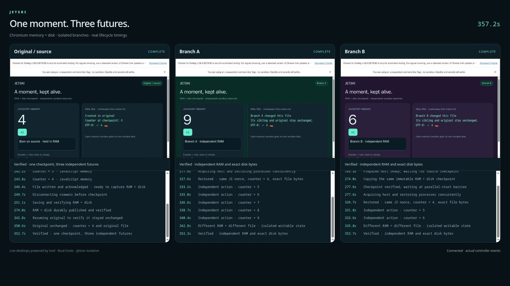

# Chromium memory + disk fork

One Chromium desktop reaches counter **4**, writes a real UTF-8 file, and saves
RAM + disk. Two independent sandboxes restore that checkpoint, keep the same
JavaScript instance, then diverge to **9** and **6**. The original resumes at **4**.

[Watch the optimized demo (1m38s)](optimized-demo.mp4)



The recorded workflow took **5m53s**, including **3m13s preparation**, on three
physical Boat hosts with the configured image/runtime/resources. Durable save/
verification took 23s and branch resume operations 48s each. These are individual
observations, not universal guarantees. Long waits in the viewing copy are labelled
16× while its clock retains real elapsed time. The full movie is 6m00s.
[Comparison conditions and limits](../../maintainer/benchmarks/chromium.md).

## The API underneath

Before creating the source, the driver uses `jetski.prepareHosts({ count: 3,
operationId })`. It prepares approved images/runtime once; it does not maintain
a permanent pool or create synthetic workloads. Preparation is paid work and
appears in the recorded timeline. Then:

```ts
const checkpoint = await source.suspend({
  portable: { codec: "gzip", chunkBytes: 4 * 1024 ** 2, reuse: true },
});
const branches = await Promise.all(
  branchIds.map((id) =>
    jetski.fromCheckpoint({
      id,
      sourceSandboxId: source.id,
      checkpointId: checkpoint.id,
      content: "memory",
    }),
  ),
);
await Promise.all(branches.map((branch) => branch.resumeMemory()));
```

Memory copying is explicit; filesystem-only remains the default. Copies have
independent retained objects and writable disks. `resumeMemory()` rejects
filesystem fallback instead of claiming RAM survived. `index.ts` contains stable
operation IDs, viewer draining, automated actions, independent state checks and
bounded cleanup. This example deliberately has more machinery than the numbered
introductory examples because it records and checks a complete fork workflow.

## Run the demo

Uses the released `@firtoz/jetski@0.3.0` package. No root install or Jetski build
is required:

```sh
cd examples/07-memory-fork
npm install
export BOAT_API_TOKEN='your token'
export JETSKI_IMAGE='your approved Playwright/Noble image@sha256:…'
export JETSKI_VOXL_ARTIFACT='/absolute/path/to/artifact.tar.gz'
export JETSKI_DEMO_DIRECTORY='/absolute/path/to/a-new-demo-directory'
npm start
```

The image needs Chromium in `/ms-playwright`, Xvfb, Node.js and Python 3.12+.
Build Voxl from reviewed source for matching Linux/glibc. The archive contains
`voxl`, shared libraries in `lib/`, and `manifest.json`, mapping each file to
`{ bytes, sha256 }`. See [upstream build instructions](https://github.com/tembo/voxl#usage);
tested commit: `c0f1ac06a61f998345ca0d4e4acc4f28fd8937fc`. A hash manifest checks
transfer integrity, not whether an untrusted executable is safe.

Open the dashboard link saved in `connection-private.json` inside the private demo
directory. It contains a viewer credential: do not commit it or the run directory.
The dashboard embeds actual authenticated Voxl streams and monotonic lifecycle
logs. Spinners show actual work, not simulated provisioning.

The measured defaults prepare three owner-scoped hosts, copy up to 256 objects per
turn, use 4 MiB memory chunks and four-way control-object writes, and opt into Boat
binary archive reads. General core defaults remain conservative. Optional controls:

- `JETSKI_DEMO_PREPARE_HOSTS=0`: demand-created hosts.
- `JETSKI_DEMO_MEMORY_CHUNK_BYTES=1048576`: finer 1 MiB incremental chunks.
- `JETSKI_DEMO_MEMORY_CONCURRENCY=1` or `2`: less parallel upload pressure.
- `JETSKI_DEMO_BINARY_READS=0`: control-protocol archive reads.

## Recording

Set `JETSKI_RECORD_CHROMIUM` to an **existing** Chromium executable and have ffmpeg
on PATH before starting. Recording uses a fresh headless profile, not your desktop
or personal profile. Timestamped JPEG captures preserve real elapsed time; MP4
encoding follows. Capture is bounded to 30 minutes and 4 GiB of frames. The raw video
is `memory-fork.mp4`; failed runs and operation IDs remain distinguishable. The
optional `viewing-copy.ts` makes labelled accelerated waits only after a successful
proof. Full timing and private stage observations remain available separately.

## Storage, durability and limits

- **Boat hosts:** Chromium, Xvfb and Voxl run inside gVisor. Each branch has its own
  sandbox identity, private network namespace and writable disk. Chromium uses
  `--no-sandbox` inside that gVisor boundary.
- **Controller machine:** the demo directory stores SQLite, immutable checkpoint
  objects, receipts and recordings. Local storage is independent of Boat disks.
  Controller disk loss is outside this durability boundary; remote object storage
  needs metadata backups too. This run does not newly qualify R2.
- **Viewer:** loopback tunnels use Jetski's authenticated SSH gateway and encrypted,
  owner-scoped host transport. Voxl authentication stays enabled.

At most three hosts run concurrently, with one-hour leases, ten-minute idle
retention and a 55-minute controller deadline. Successful close durably saves data
and retires owned hosts. Uncertain effects retain recovery state instead of forcing
deletion. Use a fresh directory; after a crash, observe recorded IDs before retry.

The oracle compares the original random JS nonce, initialization timestamp,
counter, memory-only textarea and exact file bytes, then verifies independent
changes and unchanged original. No reload, localStorage or profile reconstruction
substitutes for RAM continuation. Viewers drain before capture. Runtime/image/CPU/
kernel compatibility can reject resume. Audio and cross-provider migration are
outside this demo. Cloning RAM also clones external credentials and pending intent;
external services do not roll back with the sandbox.
